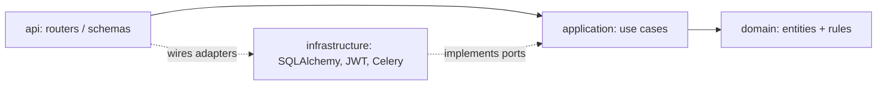

# Task Manager — Full Stack (FastAPI + React)

A task management system: users register and log in with JWT, create / read / update / delete
tasks, assign them to other users, mark them as completed and filter them by status and due date.

- **Backend:** FastAPI · SQLAlchemy 2 · PostgreSQL · Alembic · JWT · slowapi · Celery + Redis
- **Frontend:** React + TypeScript + Vite
- **Frontend:** React 19 · TypeScript · Vite · React Router 7 · TanStack Query
- **Quality:** pytest (99% coverage, 80% enforced) · Vitest + Testing Library (24 tests, ~99% coverage) ·
  ruff · mypy (strict) · ESLint · pre-commit · GitHub Actions

---

## Quick start (Docker)

```bash
docker compose up --build
```

| Service      | URL                                   |
| ------------ | ------------------------------------- |
| **Frontend** | **http://localhost:3000**             |
| API          | http://localhost:8000                 |
| Swagger UI   | http://localhost:8000/docs            |
| ReDoc        | http://localhost:8000/redoc           |
| PostgreSQL   | localhost:5432 (`taskuser`/`taskpass`) |
| Redis        | localhost:6379                        |

On start-up the `api` container runs the migrations (`alembic upgrade head`) and an
**idempotent seed**, so the demo data is always available.

### Demo credentials

| Email            | Password    |
| ---------------- | ----------- |
| admin@demo.com   | `Demo1234!` |
| john@demo.com    | `Demo1234!` |
| jane@demo.com    | `Demo1234!` |

On the login page click **Use demo account**. In Swagger, click **Authorize** and use the email
as `username`.

---

## Local development (without Docker for the API)

Requirements: Python 3.12+, [uv](https://docs.astral.sh/uv/), Docker (only for Postgres/Redis).

```bash
docker compose up -d db redis          # infrastructure only
cd backend
cp ../.env.example .env                 # points to localhost
uv sync                                 # creates .venv with dev dependencies
uv run alembic upgrade head
uv run python -m app.infrastructure.seed
uv run uvicorn app.main:app --reload    # http://localhost:8000/docs
uv run celery -A app.infrastructure.celery_app worker --pool=solo -l info   # 2nd terminal
```

> `--pool=solo` is needed for the Celery worker on Windows.

**Without Docker at all** (SQLite + Celery jobs executed inline, no Redis needed):

```powershell
cd backend
$env:DATABASE_URL = "sqlite:///./tasks.db"      # bash: export DATABASE_URL=...
$env:CELERY_TASK_ALWAYS_EAGER = "true"
uv run alembic upgrade head
uv run python -m app.infrastructure.seed
uv run uvicorn app.main:app --reload
```

### Frontend

```bash
cd frontend
npm install
npm run dev        # http://localhost:5173
npm test           # Vitest
```

### Tests and quality checks

```bash
cd backend
uv run pytest              # unit + API tests, fails under 80% coverage
uv run ruff check . && uv run ruff format --check .
uv run mypy app
pre-commit install         # from the repo root, runs ruff on every commit
```

Tests run on in-memory SQLite and need no Docker, Postgres or Redis.

```bash
cd frontend
npm test && npm run lint && npm run typecheck
```

---

## API overview

All endpoints are under `/api/v1`. Everything except `register` / `login` requires
`Authorization: Bearer <token>`.

| Method | Path                     | Description                                         |
| ------ | ------------------------ | --------------------------------------------------- |
| POST   | `/auth/register`         | Create a user                                       |
| POST   | `/auth/login`            | OAuth2 password form → JWT access token             |
| GET    | `/auth/me`               | Current user                                        |
| GET    | `/users`                 | Active users (to choose an assignee)                |
| GET    | `/tasks`                 | Paginated list with filters                         |
| POST   | `/tasks`                 | Create a task                                       |
| GET    | `/tasks/{id}`            | Get a task                                          |
| PATCH  | `/tasks/{id}`            | Partial update (owner only)                         |
| DELETE | `/tasks/{id}`            | Delete (owner only)                                 |
| POST   | `/tasks/{id}/assign`     | Assign / unassign (`{"assignee_id": null}`)         |
| POST   | `/tasks/{id}/complete`   | Mark as completed (owner or assignee, idempotent)   |

**List query parameters:** `page` (≥1), `size` (1–100), `status`
(`pending` · `in_progress` · `completed`), `due_date_from`, `due_date_to`, `assignee_id`,
`search` (title/description). Response:

```json
{ "items": [ ... ], "total": 12, "page": 1, "size": 10, "pages": 2 }
```

---

## Architecture

```
backend/app/
├── domain/            # Entities (User, Task, TaskStatus) + business rules + domain errors
├── application/
│   ├── ports.py       # Interfaces: repositories, hasher, token service, notifier
│   ├── dto.py         # PageRequest, Page, TaskFilters, Create/Update inputs
│   └── use_cases/     # AuthService, TaskService (pure Python, no framework)
├── infrastructure/
│   ├── persistence/   # SQLAlchemy models + repositories (map ORM <-> entities)
│   ├── security.py    # bcrypt hasher, JWT token service
│   ├── celery_app.py  # Celery app, background jobs, notifier adapter
│   └── seed.py        # Demo data
├── api/               # FastAPI routers, Pydantic schemas, DI wiring, error mapping
└── core/              # Settings (pydantic-settings), rate limiter
```



- **Dependency rule:** `domain` imports nothing from the project; `application` only imports
  `domain`; frameworks live in `infrastructure` and `api`.
- **Ports & adapters:** use cases depend on `Protocol` interfaces. Production uses SQLAlchemy /
  bcrypt / PyJWT / Celery; unit tests use in-memory fakes (`tests/fakes.py`), so business rules
  are tested in milliseconds without a database.
- **Unit of work per request:** one session per request; commit on success, rollback on error.
- **Domain errors → HTTP:** use cases raise `NotFoundError`, `PermissionDeniedError`, etc.; a
  single exception handler maps them to 404/403/409/422/401.

---

## Key implementation decisions

| Topic | Decision | Why |
| --- | --- | --- |
| Framework | FastAPI | Native OpenAPI/Swagger, Pydantic validation, dependency injection. |
| Authorization | Owner can edit/delete; assignee can view and complete; others get **404** | Returning 404 (not 403) avoids revealing that a task exists. |
| PATCH semantics | Uses `model_fields_set` | Distinguishes "field omitted" from `"due_date": null` (clear it). |
| Passwords | `bcrypt` directly (not `passlib`) | `passlib` is unmaintained and breaks with bcrypt ≥ 4.1. Inputs > 72 bytes are truncated explicitly. |
| JWT | PyJWT, explicit `algorithms=[...]`, required `exp`/`sub`, `type` claim | Prevents `alg: none` attacks and token-type confusion. |
| Login errors | Same message for unknown email and wrong password | Avoids user enumeration. |
| Rate limiting | slowapi: 100/min global, 5/min on `login` & `register`, keyed by IP | Brute-force protection. Redis storage in Docker so limits are shared across processes. |
| Background jobs | Celery + Redis, notifications on assignment / completion | Jobs receive IDs (JSON serializable). No result backend (fire-and-forget). Publish errors are logged, never break the request. |
| Pagination | Offset/limit, `size` ≤ 100, stable order (`due_date NULLS LAST, id DESC`) | Simple for UIs with page numbers; the max size protects the DB. |
| Indexes | `(owner_id, status)`, `(assignee_id, status)`, `due_date`, unique `email` | Match the list query filters. |
| Migrations | Alembic, verified with upgrade → downgrade → upgrade on PostgreSQL 16 | |
| Seed | Idempotent, runs on container start | Demo data always available; safe to re-run. |

### Frontend decisions

| Topic | Decision |
| --- | --- |
| Server state | TanStack Query: caching, `keepPreviousData` (no flicker when paginating), invalidation after mutations, no retries on 4xx. |
| Filters | Kept in the URL (`?status=pending&page=2`): shareable, survive refresh, back button works. Changing a filter resets to page 1; search is debounced (300 ms). |
| Auth | JWT in `localStorage`, behind a `try/catch` wrapper. Any 401 logs the user out globally. Protected and public-only routes. |
| API client | One typed `fetch` wrapper turns FastAPI errors (including 422 arrays) into readable messages, plus a clear message for network failures and 429. |
| Permissions in UI | Edit/Delete only for the owner, Complete for owner and assignee: same rules as the API, which stays the source of truth. |
| Dates | `YYYY-MM-DD` parsed as local dates to avoid the UTC "off by one day" bug. Overdue tasks are highlighted. |
| Styling | Plain CSS with design tokens. Responsive grid (3 → 1 columns), dark mode via `prefers-color-scheme`. No UI library, to keep the bundle small (~100 kB gzip). |
| Accessibility | Labelled fields, `role="dialog"` + `aria-modal`, Escape closes modals, focus moves into the modal, `role="alert"` for errors. |
| Quality gate | Verified end-to-end with Playwright against the real API: all flows pass with **0 console warnings/errors**, and there is no horizontal overflow on an iPhone 13 viewport. |

### Known trade-offs / next steps

- Notifications are enqueued before the DB transaction commits. With real side effects
  (emails) I would use the **transactional outbox** pattern.
- Only access tokens (60 min). Refresh tokens + revocation would be the next step.
- Rate limiting is keyed by IP; behind a proxy, configure trusted `X-Forwarded-For`.
- The token lives in `localStorage` (simple, but readable by XSS). An httpOnly cookie plus CSRF
  protection would be the hardened option.

---

## Presentation & GenAI

- [PRESENTATION.md](PRESENTATION.md): user story, thought process, architecture, requirements checklist and demo script.
- [GENAI.md](GENAI.md): prompts, AI output, validation and corrections.
